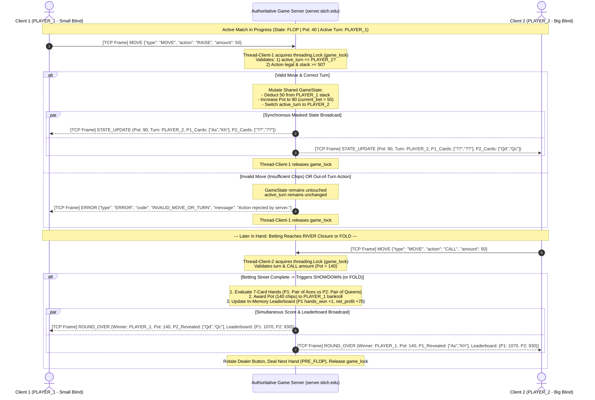

# Sprint 2: Client State, Turn & Score Synchronization Sequence
**Project:** Heads-Up Texas Hold'em Showdown (1v1 CLI Network Game)  
**Author:** Peter Kenoian  
**Course:** CS 457 – Computer Networks  

---

## 1. Turn Enforcement, Move Validation & Score Broadcast Sequence Diagram

The following Mermaid sequence diagram illustrates the complete server concurrency and synchronization flow across three critical scenarios:
1. **Valid Betting Move (`RAISE` / `CALL`):** Lock acquisition, turn & chip validation, pot/stack mutation, turn switch, and synchronous `STATE_UPDATE` broadcast with hidden card masking.
2. **Invalid or Out-of-Turn Move Rejection:** Authoritative server rejection returning an isolated `ERROR` frame without mutating state or interrupting the opponent.
3. **Round Completion & Leaderboard Synchronization:** Showdown/Fold resolution, pot settlement, in-memory leaderboard update, and simultaneous `ROUND_OVER` score broadcast to both clients.

---

## 2. Detailed Walkthrough of Synchronization Mechanics

### 2.1 Inbound Framing & Lock Acquisition (Steps 1–2)
1. **Client 1 (`PLAYER_1`)** transmits a length-prefixed JSON `MOVE` frame over its persistent TCP socket (`{"type": "MOVE", "action": "RAISE", "amount": 50}`).
2. **Thread-Client-1** (the dedicated worker thread servicing Client 1) reads the 4-byte big-endian length header followed by the JSON payload outside the lock. Once the full frame is deserialized in memory, `Thread-Client-1` acquires `self.game_lock` to enter the critical section.

### 2.2 Authoritative Validation & Branching Logic (Steps 3–6)
Inside the critical section, the server evaluates two strict preconditions before allowing any state mutation:
* **Turn Verification:** Does `self.active_turn == "PLAYER_1"`? If Client 2 attempts to send a `MOVE` packet while `active_turn == "PLAYER_1"`, `Thread-Client-2` immediately enters the `else` branch (Step 5), sends an `ERROR` frame (`code: "OUT_OF_TURN"`) solely to the offending client, and releases `self.game_lock` without altering the pot, board, or turn state.
* **Betting Rule Verification:** Does the player have sufficient chips in `player_state["PLAYER_1"]["stack"]` to cover the 50-chip raise, and does the raise meet the minimum raise increment? If not, an `ERROR` frame (`code: "INVALID_MOVE"`) is returned to the requester.

### 2.3 State Mutation & Synchronous Masked Broadcast (Steps 3–4)
When the move is valid:
1. The server atomically updates `player_state["PLAYER_1"]["stack"]`, increments `self.pot`, updates `self.current_bet`, and flips `self.active_turn = "PLAYER_2"`.
2. **Synchronous Broadcast (`par` block):** Before releasing `self.game_lock`, the server serializes and sends a `STATE_UPDATE` frame to **both** Client 1 and Client 2. Executing the broadcast inside the lock guarantees that both clients receive the exact same chronological sequence of state updates and prevents a fast client from responding to a state update before the opponent's socket has had the update queued to its OS send buffer.
3. **Card Masking:** Each client's `STATE_UPDATE` contains their own private hole cards in plaintext alongside masked placeholders (`["??", "??"]`) for their opponent's hole cards.

### 2.4 Round Resolution & Leaderboard Synchronization (Steps 6–8)
When a player action closes the final betting round on the `RIVER` (Step 6) or results in a `FOLD`:
1. While holding `self.game_lock`, the server transitions to `SHOWDOWN`, evaluates both 7-card hands (2 hole cards + 5 community cards), transfers the pot to the winning player's stack, and updates the shared `leaderboard` structure (`hands_won`, `hands_lost`, `bankroll`, `net_profit`).
2. The server broadcasts an identical `ROUND_OVER` frame to both clients simultaneously (Steps 7–8), revealing both players' hole cards (if Showdown was reached) and pushing the updated session leaderboard table so both CLI interfaces render identical scoreboards before the next hand begins.
